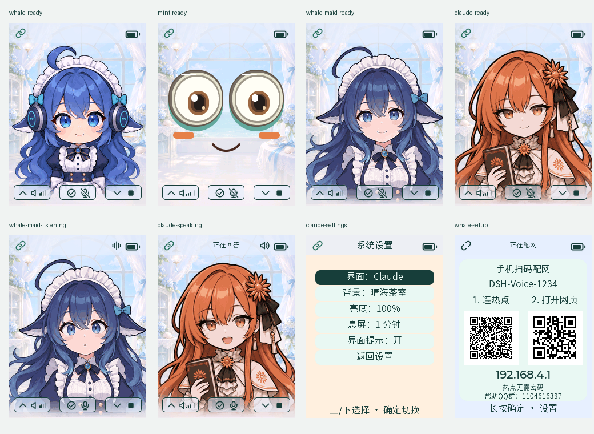
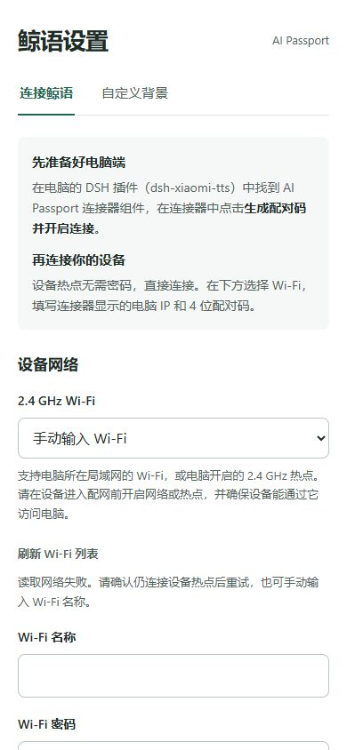
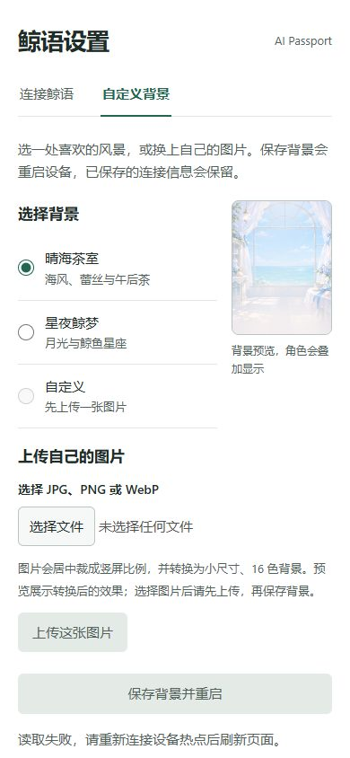
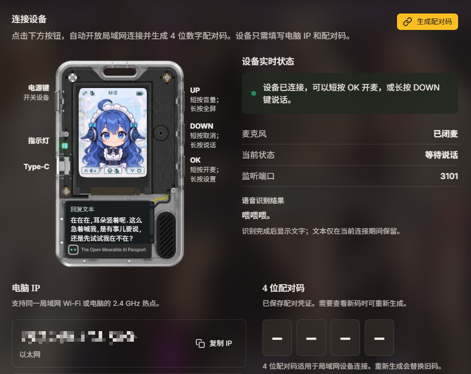

# WhaleTalk Passport · 鲸语通行证

把 FoloToy AI Passport 变成可随身携带的 DSH 语音终端。

设备收音，经 Wi-Fi 发送给电脑上的 DSH，由本机 ASR 转写、专用 Agent 对话，
再把插件生成的语音送回设备播放。设备端无需配置模型 API Key。

这是从 [dsh-xiaomi-tts](https://github.com/ppy-web/dsh-plugin-xiaomi-mimo-tts)
中独立的**设备应用仓库**，包含固件、官方 BSP、构建验证工具和连接排错技能。
DSH 的 AI Passport 连接器、ASR、Agent 与 TTS 继续由电脑端提供。

## 界面预览

内置鲸鱼娘、薄荷表情、鲸鱼娘2 和 Claude 四套界面。三套立绘各有待机、聆听、思考、说话、眨眼和错误表情。
长按 OK 打开设置，在「系统设置 → 界面」短按 OK 循环切换，再长按 OK 返回首页。选择在重启后保留。



以上由当前应用的真实 LVGL 渲染器生成，为**合成状态预览，并非实机截图**。

手机配网页默认进入「连接鲸语」，顶部 Tab 可切换到独立的「自定义背景」页面。

| 连接鲸语 | 自定义背景 |
| --- | --- |
|  |  |

网页截图为本地预览，未连接设备，因此读取配置失败、刷新、上传和保存按钮禁用属于预期状态；实际使用需连接设备热点。

背景菜单内置晴海茶室、星夜鲸梦、春日樱庭、夏日浅滩、秋枫暖湖和冬日雪屋。
可在设备「系统设置 → 背景」或手机配网页选择。
八张原始示例 PNG 也可以下载上传，见[背景示例与上传说明](docs/background-examples.md)。

## 体验

- 四套界面共用内置与自定义背景，三个实体按键。
- 设备配网热点无需密码；日常接入只填电脑 IP 与 4 位配对码。
- 默认关闭麦克风，短按 OK 开始/暂停，DOWN 取消，UP 调音量，长按 OK 设置。
- 16 kHz 录音、24 kHz 播放，完成播放后回执，再恢复收音。
- 可保留 Wi-Fi，仅修改电脑地址与配对码。

支持 ESP32-C3、8 MB Flash、240×320 屏幕、ES8311、无 PSRAM 的 AI Passport。
设备介绍与官方文档见 [AI Passport 官网](https://ai-passport.folotoy.cn/)。
电脑需要持续运行 DSH；不包含声学回声消除、声音自动打断或独立云端后台。

## 接入

给机器刷入本应用

安装>= dsh@0.2.2版本

```bash
npm install -g @deepseek-ai/dsh@latest
```

安装dsh配套插件（内有AI Passport连接器组件）

```bash
dsh plugin --profile web add dsh-xiaomi-tts@latest
```

设置好语音识别服务ApiKey（小米，豆包，Breeze）三选一，配置好确认能朗读

1. 在配套插件设置页中，找到并启用AI Passport 连接器。
2. 在 DSH 中启用语音输入，安装本地识别模型，准备好 ASR、对话模型和 配套插件 TTS 服务商。
3. 生成 4 位配对码。监听默认 `0.0.0.0:3101`，设备填写实际电脑网卡 IP。
4. 设备进入配网后，手机先扫左侧二维码加入 `DSH-Voice-*`，再扫右侧打开 `http://192.168.4.1`；也可手动连接。
5. 选择 2.4 GHz Wi-Fi，填电脑 IP 与相同配对码，保存重启，短按 OK 对话。

最多保留最近 3 组连接配置。长按 OK，在「连接设置」中切换已保存的网络，或进入「重新配置」。
同名 Wi-Fi 更新原记录，新增第 4 组替换最久未使用的一组。

连接器设置页可以生成配对码，并查看设备连接、麦克风和语音识别状态：



连接电脑的 Windows 移动热点时，电脑地址通常为 `192.168.137.1`，以系统实际网卡为准。
网页端口 `3080` 与设备接口 `3101` 独立。完整步骤与范围受限的防火墙示例见
[中文指南](docs/guide.zh_CN.md)；English readers can use the [English guide](docs/guide.md).

**Host 版本要求：** 需要包含 4 位配对、会话恢复以及发送节拍补偿的连接器。
这些配套改动独立维护在插件中；若已安装的发布版尚未包含，请使用对应的开发源码构建，
不能仅更新设备固件来获得电脑端播放节拍修正。线协议见 [protocol.md](docs/protocol.md)。

本次独立托管的是设备源码；配套连接器的开发改动仍需在插件仓库单独提交和发布，
因此暂不把此仓库作为面向普通用户的一键固件发行版。

## 开发

Windows PowerShell，从本仓库根目录执行：

```powershell
./tools/setup.ps1
. ./tools/activate.ps1
python tools/validate.py
python tools/validate.py --preview
```

ESP-IDF 固定为 **5.5.3**。工具默认安装在本仓库忽略的 `.tools/`，可以通过脚本参数
复用已有 IDF、工具和 Host 编译器；不依赖原插件所在目录。Node.js 仅字体重新生成时需要。
Linux/macOS 激活同版本 IDF、安装本机 C 编译器后也可运行 Python gate。

产物是 `build/WhaleTalk-Passport-full.bin`，按内容哈希归档的匹配 ELF/MAP 和 manifest
在 `build/firmware/`。完整镜像写 `0x0` 会影响保存的配网；兼容布局上的应用更新可按
manifest 仅写应用分区 `0x10000`。构建不会自动刷机，也不自动发布二进制。

## 给开发助手

连接、调试与排错已沉淀为
[whaletalk-connect-debug](.agents/skills/whaletalk-connect-debug/SKILL.md)，
包含主机探测、无复位串口采集和日志分析脚本。先阅读 [AGENTS.md](AGENTS.md)。

## 来源与许可

MIT，保留 FoloToy 原版权声明。UI 和对话流程参考 Qwen Voice Bean，BSP 与构建验证工具
来自 AI Passport SDK，字体为 SIL OFL 1.1。具体来源和固定参考版本见 [NOTICE](NOTICE)。
