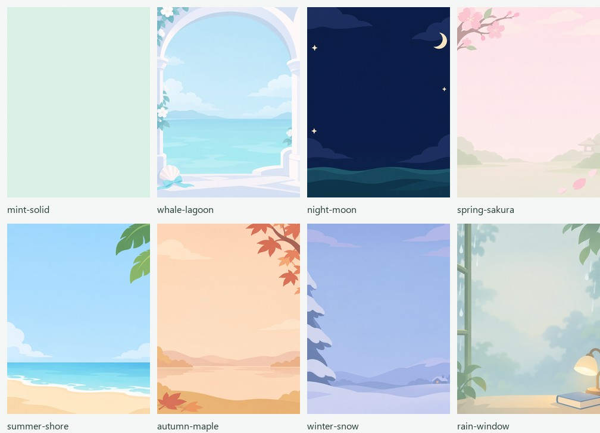

# 自定义背景示例

这组图片仅供下载、上传和制作自定义背景时参考，保存在
[`assets/backgrounds/examples/`](../assets/backgrounds/examples/)。它们不会加入固件内置背景列表，
也不会自动轮换；设备仍通过「自定义」显示你最后上传的一张图片。

上图是原始 PNG 的缩略总览，不是设备截图，也不包含角色和界面控件。
所有单张图片均为 **240×320、3:4 竖屏 RGB PNG**，无角色、文字或按钮；中间留白供表情或鲸鱼娘叠加。

| 名称 | 风格与搭配 | 单张图片 |
| --- | --- | --- |
| 薄荷素底 | 接近纯色的浅薄荷绿，适合薄荷表情，也可衬托鲸鱼娘 | [mint-solid.png](../assets/backgrounds/examples/mint-solid.png) |
| 鲸湾拱廊 | 浅蓝海湾、白色拱廊与贝壳，适合鲸鱼娘 | [whale-lagoon.png](../assets/backgrounds/examples/whale-lagoon.png) |
| 静海弯月 | 深蓝夜海与稀疏星月，适合夜间氛围 | [night-moon.png](../assets/backgrounds/examples/night-moon.png) |
| 春日樱庭 | 淡粉樱花与浅绿庭院，适合春季 | [spring-sakura.png](../assets/backgrounds/examples/spring-sakura.png) |
| 夏日浅滩 | 天蓝、海浪与暖色沙滩，适合夏季 | [summer-shore.png](../assets/backgrounds/examples/summer-shore.png) |
| 秋枫暖湖 | 杏色湖面与边角红枫，适合秋季 | [autumn-maple.png](../assets/backgrounds/examples/autumn-maple.png) |
| 冬日雪屋 | 蓝紫雪景、松树与远处暖窗，适合冬季 | [winter-snow.png](../assets/backgrounds/examples/winter-snow.png) |
| 雨窗书角 | 灰绿雨窗、书本与暖灯，适合安静的室内场景 | [rain-window.png](../assets/backgrounds/examples/rain-window.png) |

## 下载并上传

1. 点击上表中的单张 PNG。若在 GitHub 浏览，打开图片后点击 **Download raw file**，或进入 Raw 原图再保存；手机可在原图上长按保存。请下载单张 PNG，不要保存总览图或网页截图。
2. 在设备上长按 OK 进入设置，选择「上传背景」并按 OK。设备会重启进入配置热点，当前语音中断，已保存的连接配置保留。
3. 手机连接 `DSH-Voice-*`，打开 `http://192.168.4.1`，切换到「自定义背景」页签。
4. 选择下载的 PNG，检查网页转换后的预览，点击「上传这张图片」，再点击「保存背景并重启」。无需重新填写 Wi-Fi 或配对码。
5. 重启后可在设备设置的「背景」项切换内置图和自定义图。再次上传会替换当前自定义图片；设备仅保存一张自定义背景。

## 自己准备图片

也可以上传自己的 JPG、PNG 或 WebP，单张不超过 8 MB，解码后不超过 2400 万像素。
推荐使用 3:4 竖图，避免居中裁剪丢掉内容。网页会将图片转换为 **96×128、16 色**，
设备以 240×320 显示，因此颜色会简化，渐变可能出现色阶；以网页转换预览为准。
优先使用大色块、低对比留白，把装饰放在边缘，避免细小文字、密集纹理或将主体放在角色脸部位置。
两套界面都能使用这些图片，具体搭配可按喜好选择；深色夜景只改变背景，不会自动降低背光，亮度请在设置中单独调整。

## 来源

2026-11-05 使用内置 `image_gen.imagegen` 分别生成 8 张图片，再用 Pillow 等比裁剪、缩小为
240×320 RGB PNG；未修改角色、界面或固件素材编译流程。完整提示词、转换说明及成品 SHA-256 见
[`generation.json`](../assets/backgrounds/examples/generation.json)。示例图片随本仓库按 [MIT 许可证](../LICENSE) 提供。
内置背景与角色的来源另见[双界面素材说明](whale-girl-assets.md)。
